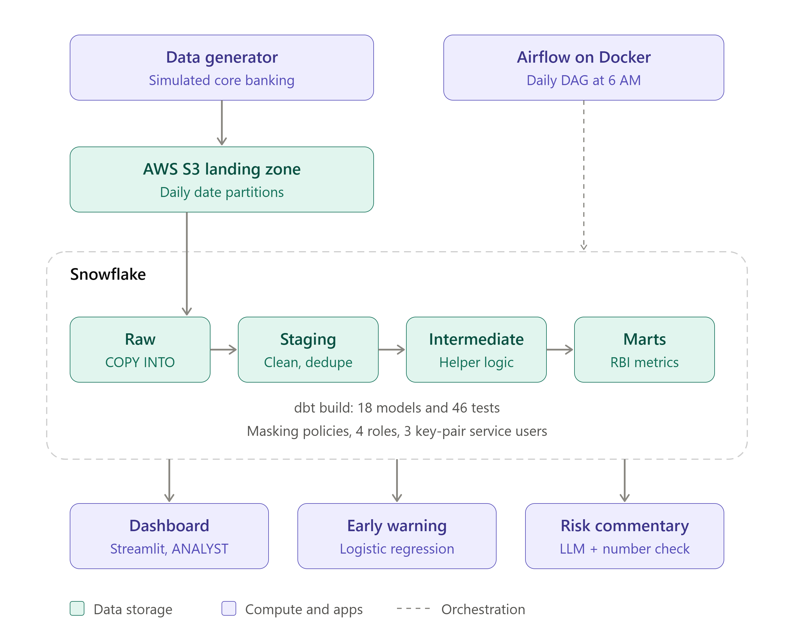
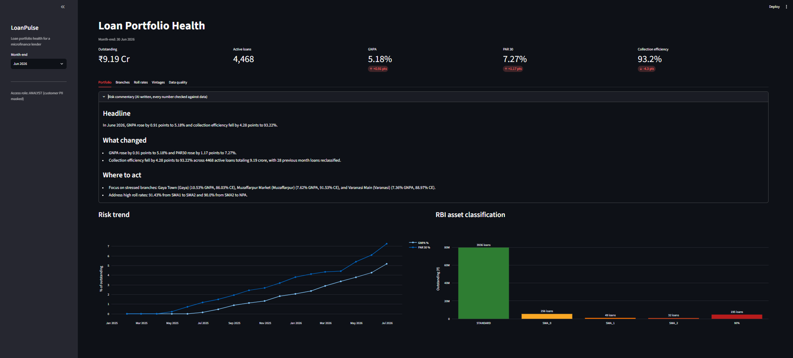
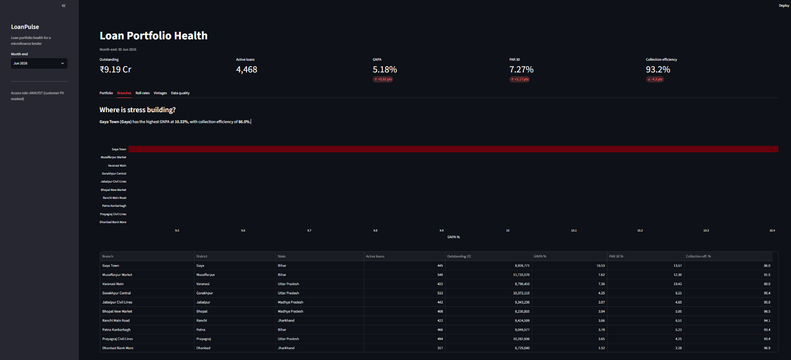
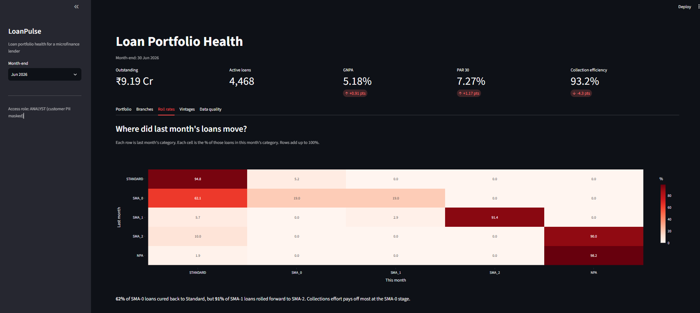
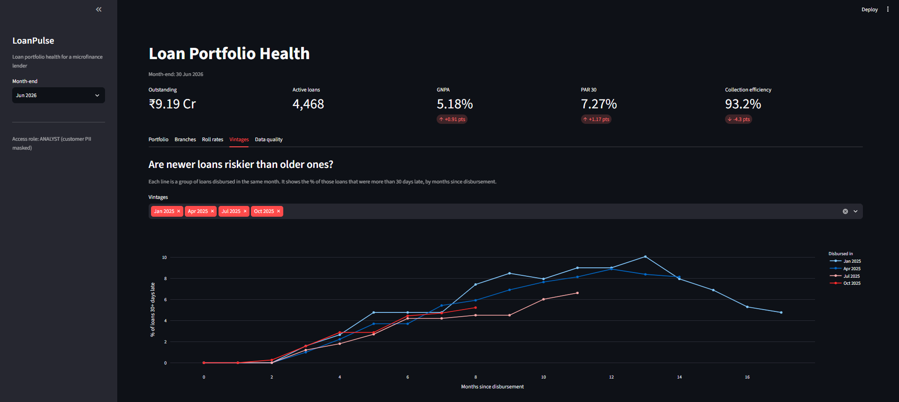
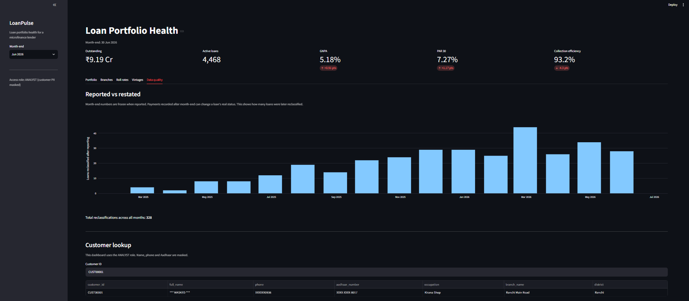

# LoanPulse: Loan Portfolio Health and Collections Platform

An end-to-end data platform for a microfinance lender. It turns scattered loan,
repayment and collection data into trusted, audit-ready risk metrics, and adds an
early-warning model and an AI-written monthly commentary on top.

**Stack:** Python · AWS S3 · Snowflake · dbt · Airflow (Docker) · Streamlit · scikit-learn · LLM (OpenRouter)

The data is synthetic, generated with realistic repayment behaviour. See
[the problem statement](docs/01_problem_statement.md) for the business context.



## The problem

A small finance bank lends to rural borrowers in joint liability groups (JLG).
Field officers collect cash and record it 0 to 3 days late. Because of that:

- Days Past Due (DPD) and RBI asset classes are wrong if you only look at recorded payments.
- Month-end numbers change when reports are re-run, so audits cannot reproduce them.
- Duplicates and corrected payments reach the reports.
- Analysts can see names, phone numbers and Aadhaar numbers they do not need.

## What it does

| Area | What is built |
|---|---|
| **Core logic** | DPD, overdue amount, outstanding principal and RBI class (Standard, SMA-0/1/2, NPA) for every loan, every day (~1.5M rows). Payments clear the oldest installment first. NPA upgrades only after all arrears are cleared. |
| **Late data** | Daily status uses `payment_date` (true status). Month-end reports use a `posted_date` cutoff (what the bank knew). |
| **Audit** | Month-end snapshots are frozen: incremental with `full_refresh = false`. A restatement report shows reported vs current numbers. |
| **Data model** | Star schema: `dim_branches`, `dim_loans`, `dim_customers`, `dim_dates` plus fact tables, with foreign key tests. |
| **History** | SCD Type 2 for master data with dbt snapshots. Corrected payments use an incremental MERGE (the latest version wins, RAW keeps every version). |
| **Quality** | 22 models, 70 tests, 3 snapshots. Business rule tests (for example the RBI NPA upgrade rule) and reconciliation tests (no rupee lost between layers). |
| **Security** | Snowflake masking policies on name, phone and Aadhaar. Roles with least privilege. Key-pair service users, no passwords. A test fails the build if PII leaks into history tables. |
| **Orchestration** | One Airflow DAG: upload to S3, load RAW, find business date, `dbt build`, health summary with a GNPA alert. Runs on Docker Compose. |
| **Dashboard** | Streamlit app: GNPA, PAR 30, collection efficiency, branch stress, roll rates, vintages, data quality. Read-only `ANALYST` role, so PII stays masked. |
| **Early warning** | Which loans 0 to 30 days late will go past 30 days within 60 days? Leakage-free features, time-based split, champion (rule) vs challenger (logistic regression). |
| **AI commentary** | SQL computes every number, the LLM only writes the text, a checker rejects any number not in the facts, and a template is the fallback. Every report keeps an audit trail. |

## Results (June 2026, synthetic data)

- Portfolio: ₹9.19 crore outstanding, 4,468 active loans.
- GNPA 5.18% (+0.91 points), PAR 30 7.27%, collection efficiency 93.22%.
- Worst branch: Gaya Town, 10.53% GNPA. Stress is built into the data on purpose.
- 328 loans were reclassified after their month-end was reported. This is why frozen snapshots matter.
- Early warning: AUC 0.82, but the model caught 49.3% of bad loans vs 50.7% for the simple rule, so the rule was kept. See [ml/model_report.md](ml/model_report.md).

## Dashboard

The Streamlit dashboard reads only the dbt marts, as the read-only `ANALYST` role, so customer PII is always masked.

**Portfolio:** KPIs, AI risk commentary, risk trend and RBI asset classes.



**Branches:** where stress is building.



**Roll rates:** how loans move between RBI categories month to month.



**Vintages:** are newer loans riskier than older ones?



**Data quality:** loans reclassified after reporting, and a customer lookup with masked name, phone and Aadhaar.



## Data flow

```
data_generator -> data/raw (CSV) -> AWS S3 -> Snowflake RAW (COPY INTO)
   -> dbt STAGING (views) -> INTERMEDIATE -> MARTS (facts, dimensions)
   -> Streamlit dashboard | early-warning model | AI commentary
                 Airflow runs the daily pipeline end to end
```

## Repository layout

```
data_generator/   Synthetic data + two simulators (master changes, payment corrections)
snowflake/        Numbered SQL scripts: setup, S3 stage, RAW, roles, masking, validation
loanpulse_dbt/    dbt project: models, snapshots, tests
airflow/          DAG, Dockerfile, docker-compose, dbt profile for the container
dashboard/        Streamlit app
ml/               Early-warning training script and report
ai/               LLM commentary generator
reports/          Generated monthly commentary
scripts/          Key-pair generator for Snowflake service users
docs/             Problem statement, glossary, data model
```

## Setup

**You need:** Python 3.11+, Docker Desktop, an AWS account (S3 bucket + IAM role) and a
Snowflake account (Enterprise edition is required for masking policies).

```powershell
python -m venv .venv
.venv\Scripts\Activate.ps1
pip install -r requirements.txt
```

### 1. Generate data

```
python data_generator/main.py          # writes data/raw (7 tables, same data every run)
```

### 2. Snowflake and S3

Run the scripts in `snowflake/` in this order. Replace the `<placeholders>` first.

| Script | Purpose |
|---|---|
| `01_setup.sql` | Warehouse, database, RAW schema, resource monitor |
| `02_storage_integration.sql`, `03_stage.sql` | Read S3 through an IAM role (no access keys) |
| `04_raw_tables.sql` | RAW tables with `_source_file` and `_loaded_at` |
| `05_load_raw.sql`, `06_validate_raw.sql` | First load and checks (`07_full_reload.sql` is for backfills only) |
| `08_dbt_access.sql` | `TRANSFORMER` role and `DBT_USER` |

```
python scripts/generate_snowflake_key.py       # prints the public key for the CREATE USER scripts
aws s3 sync data/raw s3://<your-bucket>/raw/
```

### 3. Build the models

Create `~/.dbt/profiles.yml` (profile `loanpulse_dbt`, user `DBT_USER`, role `TRANSFORMER`,
key-pair auth, schema `STAGING`). The Airflow copy in `airflow/dbt_profiles/profiles.yml` is a template.

```
cd loanpulse_dbt
dbt build
```

### 4. Security and access (after the first `dbt build`)

| Script | Purpose |
|---|---|
| `11_masking_policies.sql` | Masking on name, phone, Aadhaar |
| `12_roles_and_access.sql` | `ANALYST` and `COMPLIANCE_OFFICER` (MARTS only) |
| `13_test_access.sql` | Shows each role sees what it should |
| `14_loader_access.sql` | `LOADER` role and `LOADER_USER` for Airflow |
| `15_dashboard_access.sql` | `DASHBOARD_USER` (read only, masked) |

### 5. Run the pipeline with Airflow

```
cd airflow
copy .env.example .env      # fill in your Snowflake account and bucket
docker compose up -d
```

Open http://localhost:8081, unpause `loanpulse_daily_pipeline` and trigger it.
Your AWS and Snowflake key files are mounted read-only from your home folder.

### 6. Dashboard, model and commentary

```
copy dashboard\.streamlit\secrets.toml.example dashboard\.streamlit\secrets.toml   # fill in
streamlit run dashboard/app.py
python ml/train_early_warning.py
python ai/generate_commentary.py
```

`secrets.toml` is git-ignored. Never commit real keys.

## Try the history and correction features (optional)

Run these after a first full load. Order matters for the snapshot demo.

```
dbt snapshot                                            # version 1 of the master data
python data_generator/simulate_master_changes.py        # renamed branches, changed occupations
python data_generator/simulate_payment_corrections.py   # corrected payments (no money change)
```

Then trigger the DAG again and run `snowflake/16_validate_scd2.sql` and
`snowflake/17_validate_corrections.sql`. The default correction mode keeps every
headline number unchanged. `--with-amounts` also changes some amounts.

## Design decisions

- **RAW is source-aligned and append-only.** Nothing is transformed there, so everything can be rebuilt from it.
- **Logic lives in dbt, not in the dashboard.** The dashboard, ML and AI all read the same tested marts.
- **`dim_customers` must stay a view.** dbt sees masked values, so a table would store masked text forever.
- **Snapshots never contain PII.** A snapshot stores every source column, so `snap_customers` reads a PII-free view.
- **dbt failures are not retried in Airflow.** A failed test is a data problem, and a retry only burns credits.

## Known limitations

- Synthetic data. Defaulters stop paying suddenly, with no early warning signs, so a model has little to learn beyond "already late".
- Monthly installments only, and no partial-payment handling in outstanding principal.
- The daily status table is rebuilt from full history every run. At bank scale it would need an incremental design with a lookback window.
- Month-end snapshots use the daily table only for the NPA stickiness rule, so they are not purely point-in-time.
- The LLM checker verifies numbers, not claims. It cannot tell if a number is attached to the wrong metric.
- The daily date spine is fixed at 1,000 days from 2025-01-01.
- The Airflow DAG and dbt use one shared private key file for all service users.

## More documentation

- [Problem statement](docs/01_problem_statement.md) · [Glossary](docs/02_glossary.md) · [Data model](docs/03_data_model.md)
